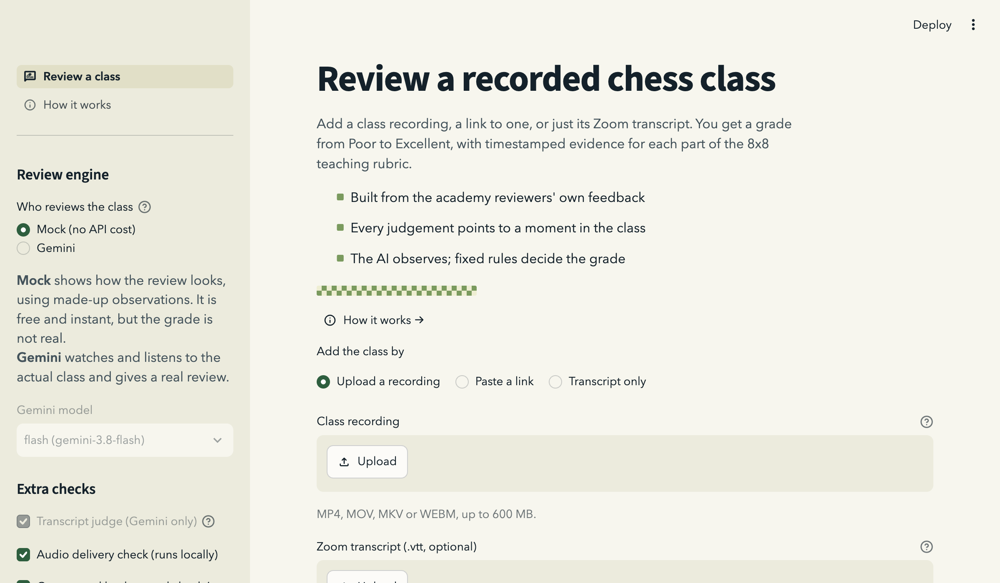
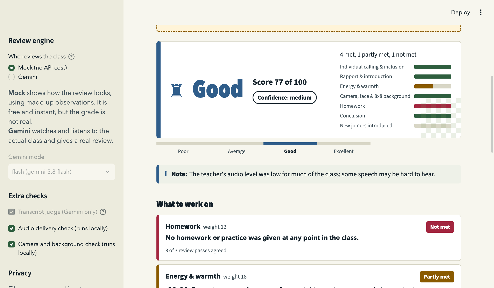
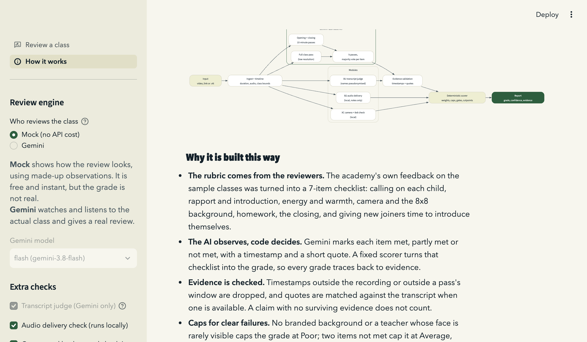
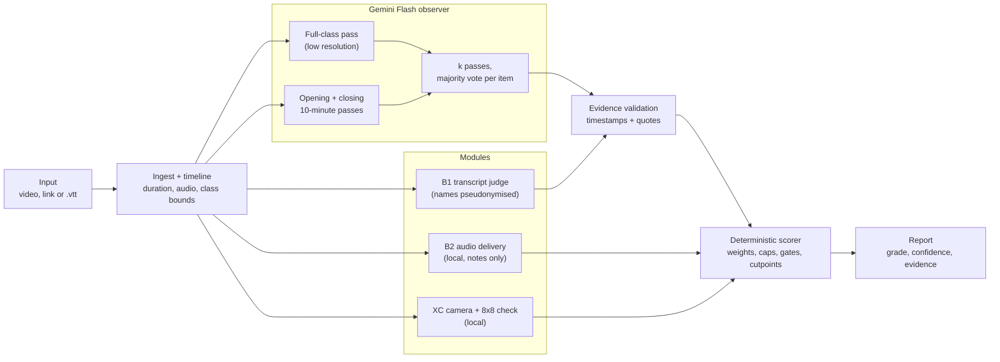

# Class Review: grading recorded online chess classes

Upload a recording of an online kids' chess class (or paste a Google Drive / direct link, or upload just the Zoom
`.vtt` transcript). The app grades it **Poor / Average / Good / Excellent** and backs the grade with timestamped
evidence for each part of the teaching rubric.

**Live app:** _link to be added after deployment_ · **Source:** https://github.com/S-hub18/humaniti_ai

| Landing | Results (mock data) | How it works |
|---|---|---|
|  |  |  |

Screenshots use the built-in mock observer and a generated test video. No real class appears in them.

## How it works



- **The rubric comes from the reviewers.** The academy's own feedback on the sample classes became a 7-item
  checklist:
  - calling on each child individually (weight 20);
  - rapport and introduction (18);
  - energy and warmth (18);
  - camera, face and the 8x8 branded background (14);
  - homework (12);
  - the closing (10);
  - new joiners introduced (8).
- **The AI observes, code decides.** Gemini Flash marks each item met, partly met or not met, with a timestamp and a
  short quote. It never picks the grade.

### Scoring

1. **Evidence validation.** A timestamp outside the recording or outside the pass's window is dropped. A quote that
   doesn't match the transcript within ±20 s is dropped. A met or partial claim with no surviving evidence becomes
   "not observed".
2. **Vote.** The observer runs several passes, and each item takes the majority. How often the passes agree becomes
   the confidence.
3. **Score.** Items are worth met = 1, partial = 0.5, not met = 0.
   - Unobserved items count at a neutral 0.5, so dropping a claim can never raise the score.
   - "Not applicable" is allowed only for new joiners.
   - Grading needs at least 5 of the 7 items observed.
4. **Caps** (they only ever lower a grade):
   - No branded background, or a face that is rarely visible: capped at Poor.
   - Two items not met: capped at Average. Three or more: capped at Poor.
   - If the AI and the local camera check disagree, confidence is lowered instead of the grade being capped.
5. **Cutpoints.** Poor below 50, Average 50–67, Good 68–83, Excellent 84 and above. They were fixed before
   evaluation; leave-one-out tuning may move them by at most ±8.
6. **Other session types.** Trial/demo sessions are detected and reported without a grade. Transcript-only reviews
   leave the camera item unscored and cap confidence at medium.

Full design: [`docs/design/system-design.md`](docs/design/system-design.md). Plan:
[`docs/plans/`](docs/plans/).

## Run locally

Requires Python 3.12, [uv](https://docs.astral.sh/uv/) and ffmpeg.

```bash
uv sync
uv run streamlit run app/streamlit_app.py
```

The app opens in **Mock mode**, which runs the whole pipeline with a built-in demo observer and no API calls. Use
"Run a sample review" to see a report.

### Environment variables

Put these in the environment or in a local `.env` file. `.env` and `.env.*` are git-ignored and docker-ignored.

| Variable | Default | Meaning |
|---|---|---|
| `GEMINI_API_KEY` | (unset) | Required for Gemini mode. |
| `CQA_GEMINI_MODEL` | `gemini-3.8-flash` | Optional override. **Flash / Flash-Lite only**; Pro models are rejected in code. |
| `FREE_TIER` | `1` | Spaces Gemini calls about 65 s apart and waits out rate limits. Set it to `0` for a paid key. |

## Deploy (Docker / Hugging Face Spaces)

```bash
docker build -t class-review .
docker run -p 7860:7860 -e GEMINI_API_KEY=... class-review
```

On Hugging Face Spaces (Docker SDK), add `GEMINI_API_KEY` as a Space secret. The upload limit is 600 MB, and the
theme is fixed in `.streamlit/config.toml`. Only one Gemini review runs at a time across all users, because they share
one quota; other users are told they're next.

### Streamlit Community Cloud

1. New app, then pick this repo, branch `main`, main file `app/streamlit_app.py`. Python 3.12.
   - Dependencies install from `uv.lock`.
   - System packages come from `packages.txt` (`ffmpeg`, which provides `ffprobe`).
2. Under **Settings, then Secrets**, add your key in TOML format:

   ```toml
   GEMINI_API_KEY = "your-key"
   # optional
   FREE_TIER = "1"
   ```

   Top-level secrets are exposed to the app as environment variables. The key is never logged.
3. **After every push, reboot the app (Manage app, then Reboot).** Streamlit hot-reloads only the main script, so
   already-imported `cqa` modules stay on the old version until a reboot. That shows up as an `ImportError` at
   startup.
4. Community Cloud has about 1 GB of RAM. Uploads are streamed to disk, but very large recordings can still be tight.
   Prefer a Google Drive link, or keep uploads well under the 600 MB limit.

## Evaluation

```bash
uv run pytest -q                                               # 199 tests, no API calls
uv run python -m eval.run_eval --observer mock                 # harness smoke run (numbers are NOT results)
uv run python -m eval.run_eval --observer gemini [--b1]        # real eval (costs API credits)
uv run python -m eval.run_eval --mode transcript --observer gemini   # transcript-only vs video
uv run python -m eval.variants --list                          # counterfactual / invariance video edits
```

The harness reports:
- grades: exact accuracy, within-one accuracy, MAE, Spearman and pairwise ordering, each against a
  "most common grade" baseline;
- leave-one-out cutpoint tuning;
- run-to-run variance;
- per-item accuracy against the reviewers' notes, and separately against our own transcript annotations;
- cost and latency;
- an ablation table;
- demo sessions as out-of-distribution checks.

Two classes are held out and scored once.

**Results so far:**
- **Live:** one class. On B472, which the reviewers rated Excellent, the full-class Gemini pass gave Excellent,
  about 95/100; 11 of 12 evidence items survived validation. One class is not an evaluation.
- **Annotation ceiling:** careful human annotation from transcripts agreed with the reviewers 51% exactly and 91%
  within one step.
- **A local classifier we tried (laya)** scored 15/21 on item labels, the same as always guessing the most common
  answer, so we dropped it.
- **Simulated flow review** (agents acting as the observer on 4 hard classes): both quality-issue classes came out
  Poor through the compliance caps, the average class came out Average, and one weak class came out Average, one grade
  too high.
- **Grade-level accuracy rests on 10 labelled classes.** Item, pairwise and variant results are supporting evidence
  only.

## Privacy and data handling

- Recordings show children. They are never committed: `class recordings*/`, `.scratch/` and `.env*` are git-ignored
  and docker-ignored.
- Uploads go to a temporary folder and are deleted as soon as the review is built. The app stores nothing and keeps no
  disk cache.
- Children's names are replaced with Kid1, Kid2… locally before any transcript is scored. A fail-closed check blocks
  scoring if a known name survives. The model is told never to name or describe children.
- In Gemini mode the recording is uploaded to the Gemini API and deleted from it after the review.
- The development key was free tier, whose terms may allow data use. Production use needs a paid tier and the
  organiser's approval.

## Limitations

- Only 10 labelled classes, so the cutpoints and weights are priors, not fitted values.
- Mild weaknesses can read as "partly met" rather than "not met". One weak class landed in Average in the simulated
  review.
- On the free tier a one-hour class takes about 10–15 minutes.
- Transcripts from Zoom garble names and chess notation, and audio-only transcription of mixed-language classes is
  untested.
- The local camera and logo check assumes Zoom's layout with a top-right speaker tile.

## More

- 300-word writeup: [`docs/writeup.md`](docs/writeup.md)
- AI interaction history (redacted): [`docs/ai-history/`](docs/ai-history/)
